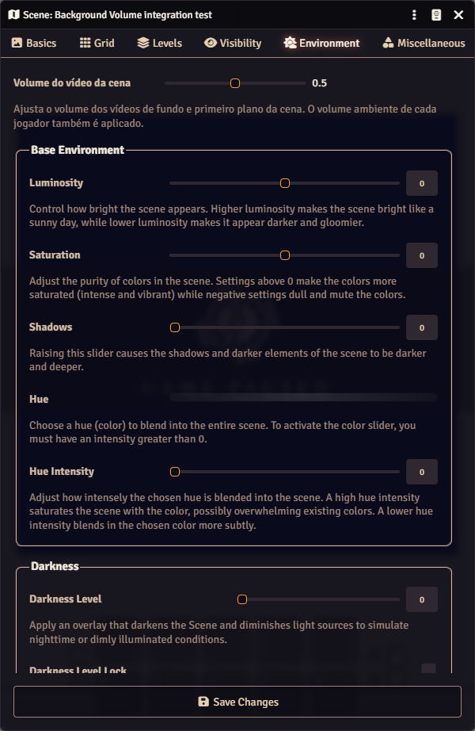

# RPG Up - Background Volume

Cópia mantida por **henriquebot**, adaptada para **Foundry VTT 14** e validada no **14.370**.
Baseada no [Background Volume de Michael Volling Jr.](https://github.com/mtvjr/background-volume), versão 1.7.0, commit [`1c72472`](https://github.com/mtvjr/background-volume/commit/1c72472ab6e0ce7deb5af8e82d3d2ac4657c9578).

Permite ao mestre ajustar o volume dos vídeos de fundo e primeiro plano da cena, incluindo seus níveis. O volume final combina a configuração da cena com o volume ambiente local de cada jogador. O volume dos vídeos de tiles e tokens continua sob controle do Foundry.

## Instalação

No Foundry, abra **Add-on Modules → Install Module** e cole este endereço em **Manifest URL**:

```text
https://raw.githubusercontent.com/henriquebot/RPG-Up-Background-volume/main/module.json
```

Ative **RPG Up - Background Volume** em **Manage Modules** dentro do mundo.

O identificador continua sendo `background-volume`: esta versão substitui o módulo original e aproveita as configurações já salvas nas cenas. Use apenas uma instalação com esse identificador. É destinado ao Foundry v14.

O pacote está disponível diretamente neste repositório: [background-volume-1.8.0.zip](dist/background-volume-1.8.0.zip).

## Uso

1. Abra a configuração da cena.
2. Selecione a aba **Environment** (Ambiente).
3. Ajuste **Volume do vídeo da cena** / **Background Volume** entre 0 e 1.
4. Clique em **Save Changes** para salvar.

Exemplo: cena em `0.25` e volume ambiente em `0.60` produzem volume final de `0.15`. O valor `0` silencia o vídeo da cena. Playlists e sons ambientes continuam com os controles próprios do Foundry. O navegador pode exigir um clique na página para liberar a reprodução de áudio.



## Alterações na versão 1.8.0

- Integração com a aba Environment do SceneConfig v14 e salvamento nativo da flag junto com o formulário.
- Uso do evento público de alteração de volume ambiente, sem substituir funções internas de configurações.
- Atualização do volume ao carregar a cena, mudar de nível ou alterar a configuração da cena.
- Controle restrito aos vídeos de fundo/primeiro plano dos níveis; preserva o áudio independente de tiles e tokens.
- Tradução pt-BR, validação de volumes e nove testes automatizados.
- Manifesto e ZIP direcionados a este repositório, sem dependência das releases do projeto original.

## Desenvolvimento e verificação

```sh
npm test
python tools/build.py
```

Os testes usam apenas o Node.js; o empacotamento usa a biblioteca padrão do Python. Consulte [TESTING.md](TESTING.md) para os resultados da validação real no Foundry 14.370. O ZIP contém `module.json` na raiz e é gerado manualmente.

## Créditos e licença

Código original: **Michael Volling Jr.** Traduções originais: **Lozalojo** (espanhol), **Nathan Wukasch** (hindi), **Sebastian Will** (alemão) e **Yuan Qu** (chinês). Manutenção para v14 e tradução pt-BR: **henriquebot**.

A [licença MIT original](LICENSE) foi preservada. Este fork não é uma publicação oficial do autor original. Para problemas nesta adaptação, use as [issues deste repositório](https://github.com/henriquebot/RPG-Up-Background-volume/issues).
